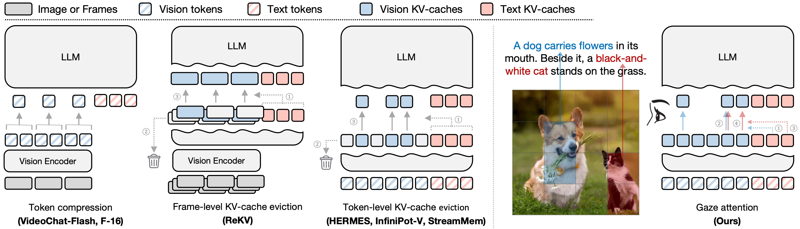

# Gaze Attention: Query-Adaptive Visual Routing for Efficient Multimodal LLMs

Official implementation of **Gaze Attention**.

> **Gaze Attention: Query-Adaptive Visual Routing for Efficient Multimodal LLMs**<br>
> Junha Song, Byeongho Heo, Geonmo Gu, Jaegul Choo, Dongyoon Han, Sangdoo Yun<br>
> NAVER AI Lab, KAIST

<p align="center">
    
</p>

<div align="center">
<a href="https://arxiv.org/abs/2605.13080" target="_blank">
    
</a>
<a href="https://june-page.github.io/gaze-attention" target="_blank">
    
</a>
<br>
</div>

Multimodal LLMs attend to all visual tokens at every generation step. Gaze Attention lets every query attend
to the few visual regions it needs:

- **Gaze regions and descriptors.** The cached keys of the visual tokens are grouped into spatial regions
  (6 x 6 tokens by default). Each region is summarized by a descriptor, the mean of its keys.
- **Visual routing.** At every decoding step, the query scores the descriptors and attends only to the TopK regions.
  The selection is made per layer, per head and per token. The KV cache is kept complete, so a region that is
  skipped at one step can be selected at the next one.
- **Learnable context tokens.** A few learnable tokens are appended to every image or frame. They summarize their
  frame and stay visible to all queries, which keeps the global view of the scene.
- **Progressive TopK schedule.** Training starts with nearly dense attention (90% of the regions) and reduces the
  number of selected regions step by step to 10%.

```
sequence   [frame 0 patches x576] [ctx x4] [frame 1 patches x576] [ctx x4] [question ... answer ...]
modality    IMAGE ...              CTX      IMAGE ...              CTX      TEXT ...

text query --> scores the region descriptors --> attends to: TopK regions + all context tokens + text
```

## Contents

- [Installation](#installation)
- [Models](#models)
- [Inference](#inference)
- [Evaluation](#evaluation)
- [Training](#training)
- [Repository layout](#repository-layout)

## Installation

Tested with Python 3.10, PyTorch 2.2.2 (CUDA 12.1) and H100 GPUs. Inference and training also work with PyTorch 2.5.1.

```bash
git clone https://github.com/junha1125/Gaze-Attention.git
cd Gaze-Attention

conda create -n gaze python=3.10 -y
conda activate gaze
pip install --upgrade pip

# 1. PyTorch
pip install torch==2.2.2 torchvision==0.17.2

# 2. This repository (package name: cambrian)
pip install -e .                    # inference only
pip install -e ".[train,eval]"      # + training (DeepSpeed) and image benchmarks

# 3. Optional: lmms-eval for the video benchmarks
bash lmms_eval_integration/setup.sh
```

Main pinned versions: `transformers==4.51.0`, `tokenizers~=0.21`, `accelerate<=1.12.0`, `deepspeed==0.14.4`,
`numpy==1.26.4`, `datasets==2.21.0`.

## Models

| Model | Input | Visual tokens | Attended visual KV entries | Finetuning data | Weights |
|---|---|---:|---|---|---|
| `gaze-attention-qwen3-4b-384` | image, 384px | 576 | 72 + 4 context tokens | Cambrian-7M | [Hugging Face](https://huggingface.co/junha1125/gaze-attention-qwen3-4b-384) |
| `gaze-attention-qwen3-4b-384-onevision` | image, 384px | 576 | 72 + 4 context tokens | LLaVA-OneVision | [Hugging Face](https://huggingface.co/junha1125/gaze-attention-qwen3-4b-384-onevision) |
| `gaze-attention-qwen3-4b-512` | image, 512px | 1,024 | 128 + 4 context tokens | LLaVA-OneVision | [Hugging Face](https://huggingface.co/junha1125/gaze-attention-qwen3-4b-512) |
| `gaze-attention-qwen3-4b-video` | video, 384px, 4x token compression | 144 per frame | 10% of the regions + 4 context tokens per frame | Cambrian-7M subsets, then Cambrian-S-3M subset | [Hugging Face](https://huggingface.co/junha1125/gaze-attention-qwen3-4b-video) |

All models use SigLIP2-So400m/16 as the vision encoder and Qwen3-4B-Instruct as the language model.

## Inference

```bash
# image
python demo/image_inference.py --model-path <checkpoint> \
    --image assets/example2_dog.jpg --question "Describe this image."

# video
python demo/video_inference.py --model-path <video checkpoint> \
    --video assets/jobs.mp4 --question "Describe what happens in this video." --max-frames 64
```

`<checkpoint>` is a local folder or a Hugging Face model id. In Python:

```python
import copy
import torch
from PIL import Image

from cambrian.constants import DEFAULT_IMAGE_TOKEN, IMAGE_TOKEN_INDEX
from cambrian.conversation import conv_templates
from cambrian.mm_utils import process_images, tokenizer_image_token
from cambrian.model.builder import load_pretrained_model

tokenizer, model, image_processor, _ = load_pretrained_model(
    "<checkpoint>", None, "cambrian_qwen3", device_map="cuda:0", attn_implementation="sdpa"
)  # Gaze Attention is enabled automatically for checkpoints that were trained with it
model.eval()

image = Image.open("assets/example2_dog.jpg").convert("RGB")
image_tensor = process_images([image], image_processor, model.config)
image_tensor = [x.to(dtype=torch.float16, device="cuda:0") for x in image_tensor]

conv = copy.deepcopy(conv_templates["qwen_3"])
conv.append_message(conv.roles[0], DEFAULT_IMAGE_TOKEN + "\nDescribe this image.")
conv.append_message(conv.roles[1], None)
input_ids = tokenizer_image_token(conv.get_prompt(), tokenizer, IMAGE_TOKEN_INDEX, return_tensors="pt").unsqueeze(0).to("cuda:0")

output_ids = model.generate(input_ids, images=image_tensor, image_sizes=[image.size], do_sample=False, max_new_tokens=512)
print(tokenizer.batch_decode(output_ids, skip_special_tokens=True)[0])
```

`generate` takes the arguments of the Hugging Face `generate` method (sampling, beam search, `num_return_sequences`).
Several `<image>` placeholders in one prompt, prompts without an image and batches of prompts are supported; for a
batch, pass padded `input_ids` together with their `attention_mask` and one image tensor per `<image>` placeholder.

**Less GPU memory.** `load_pretrained_model(..., load_8bit=True)` or `load_4bit=True` loads the language model with
8-bit or 4-bit weights (`pip install bitsandbytes`): the weights then need about 4.5 GB or 2.7 GB of GPU memory instead
of 8.2 GB.

**Number of attended regions.** `gaze_topk_ratio` is the fraction of gaze regions that a query attends to
(`TopK = ceil(ratio x number of regions)`). It is stored in the checkpoint config and can be changed when the model is loaded:

```python
load_pretrained_model(..., overwrite_config={"gaze_topk_ratio": 0.25})
python demo/image_inference.py --model-path <checkpoint> --gaze-topk-ratio 0.25
```

| Visual tokens per image | Region size | Regions | `gaze_topk_ratio` | Attended visual KV entries |
|---|---|---:|---:|---|
| 576 (384px) | 6 x 6 | 16 | 0.1 | 2 x 36 + 4 context tokens = 76 |
| 576 (384px) | 6 x 6 | 16 | 0.25 | 4 x 36 + 4 = 148 |
| 1024 (512px) | 8 x 8 | 16 | 0.1 | 2 x 64 + 4 = 132 |
| 144 per frame (384px, 4x token compression) | 6 x 6 | 4 per frame | 0.1 | 10% of all regions of the video + 4 per frame |

## Evaluation

| Benchmarks | Tool | Guide |
|---|---|---|
| Image benchmarks (MME, MMBench, GQA, ScienceQA, ChartQA, TextVQA, ...) | evaluation suite in `eval/` | [eval/README.md](eval/README.md) |
| Video benchmarks (Video-MME, MLVU, EgoSchema, LongVideoBench, NExT-QA, TempCompass) | lmms-eval | [lmms_eval_integration/README.md](lmms_eval_integration/README.md) |

```bash
# image benchmarks, one process per GPU
cd eval
CUDA_VISIBLE_DEVICES=0,1,2,3,4,5,6,7 bash scripts/run_all_benchmarks.sh <checkpoint>
python scripts/tabulate.py --eval_dir eval --out_pivot pivot.xlsx --out_all_results all_results.csv
cd ..

# video benchmarks, 64 frames per video
NUM_GPUS=8 bash lmms_eval_integration/run_video_benchmarks.sh <video checkpoint> 64
```

The benchmark datasets are downloaded from the Hugging Face Hub. Log in with your own token first
(`huggingface-cli login`): anonymous downloads are rate-limited and LongVideoBench is gated.

## Training

### Data

[data_preparation/README.md](data_preparation/README.md) explains how to download and preprocess the training data.

| Stage | Data |
|---|---|
| 1. Projector and context tokens | Cambrian-Alignment |
| 2. Image finetuning | Cambrian-7M, or LLaVA-OneVision + Cambrian-7M subset |
| 3. Video finetuning (video models) | Cambrian-S-3M subset |

### Recipes

Training uses DeepSpeed (ZeRO-2) through `torchrun`. Each recipe is a sequence of scripts; every script reads the
output of the previous one.

| Recipe | Visual tokens | Scripts |
|---|---|---|
| Image, 384px | 576 per image | [`scripts/train/image_384`](scripts/train/image_384) |
| Image, 512px | 1024 per image | [`scripts/train/image_512`](scripts/train/image_512) |
| Video, 384px, 4x token compression | 144 per frame | [`scripts/train/video_384`](scripts/train/video_384) |

```bash
export DATA_ROOT=/path/to/datasets      # default: ./datasets
export OUTPUT_ROOT=./checkpoints        # default
export NUM_GPUS=8                       # GPUs per node

# Gaze Attention, image, 384px
bash scripts/train/image_384/1_pretrain_projector.sh         # stage 1-1: projector
bash scripts/train/image_384/2_pretrain_context_tokens.sh    # stage 1-2: context tokens
bash scripts/train/image_384/3_finetune_gaze_cambrian7m.sh   # stage 2: full finetuning, progressive TopK
```

| Stage | Trained parts | Learning rate | Total batch size |
|---|---|---|---:|
| 1-1 Projector | projector | 1e-3 | 512 |
| 1-2 Context tokens | projector, context-token embeddings | 1e-3 | 512 |
| 2 / 3 Finetuning | vision encoder, projector, language model | 1e-5 (vision encoder 2e-6) | 256 or 512 |

**Notes.** [Implementation notes](cambrian/model/language_model/README.md) explain how it is wired into the model.

**Batch size and GPUs.** The scripts keep the total batch size fixed and derive the gradient accumulation steps from
the number of GPUs: `total batch size = GPUs x per-GPU batch size x accumulation steps`.
Set `TOTAL_BATCH` and `PER_DEVICE_BATCH` to change them.

**Hardware.** The released models were trained on 32 H100 GPUs (4 nodes with 8 GPUs): stage 2 on Cambrian-7M took
53 hours, the video finetuning 52 hours. One node with 8 H100 GPUs processes about 17 samples per second in stage 2
(about 4.7 days for Cambrian-7M).

**Logging.** `REPORT_TO=wandb` logs to Weights & Biases (after `wandb login` with your W&B API key); the default is `none`.

## Repository layout

```
cambrian/                     model and training code (package `cambrian`)
  model/language_model/       Gaze Attention, Qwen2.5 / Qwen3 model classes
  model/cambrian_arch.py      visual tokens, context tokens and modality map of the input sequence
  train/                      training entry point, trainer with the progressive TopK schedule, data loading
demo/                         image and video inference examples
scripts/train/                training recipes
data_preparation/             download and preprocessing of the training data
eval/                         image benchmark suite
lmms_eval_integration/        lmms-eval setup for the video benchmarks
tests/                        unit tests of the attention implementation
```

## Citation

```bibtex
@inproceedings{song2026gazeattention,
  title={Gaze Attention: Query-Adaptive Visual Routing for Efficient Multimodal {LLM}s},
  author={Junha Song and Byeongho Heo and Geonmo Gu and Jaegul Choo and Dongyoon Han and Sangdoo Yun},
  booktitle={Third Conference on Language Modeling (CoLM)},
  year={2026}
}
```

## Acknowledgements

This repository is built on [LLaVA-OneVision / LLaVA-NeXT](https://github.com/LLaVA-VL/LLaVA-NeXT).
The image evaluation suite is adapted from [Cambrian-1](https://github.com/cambrian-mllm/cambrian), and the video
benchmarks run with [lmms-eval](https://github.com/EvolvingLMMs-Lab/lmms-eval).
The models use [SigLIP2](https://huggingface.co/google/siglip2-so400m-patch16-384) and
[Qwen3](https://huggingface.co/Qwen/Qwen3-4B-Instruct-2507).

## License

Apache License 2.0, see [LICENSE](LICENSE). The training datasets and the pretrained models have their own licenses.
